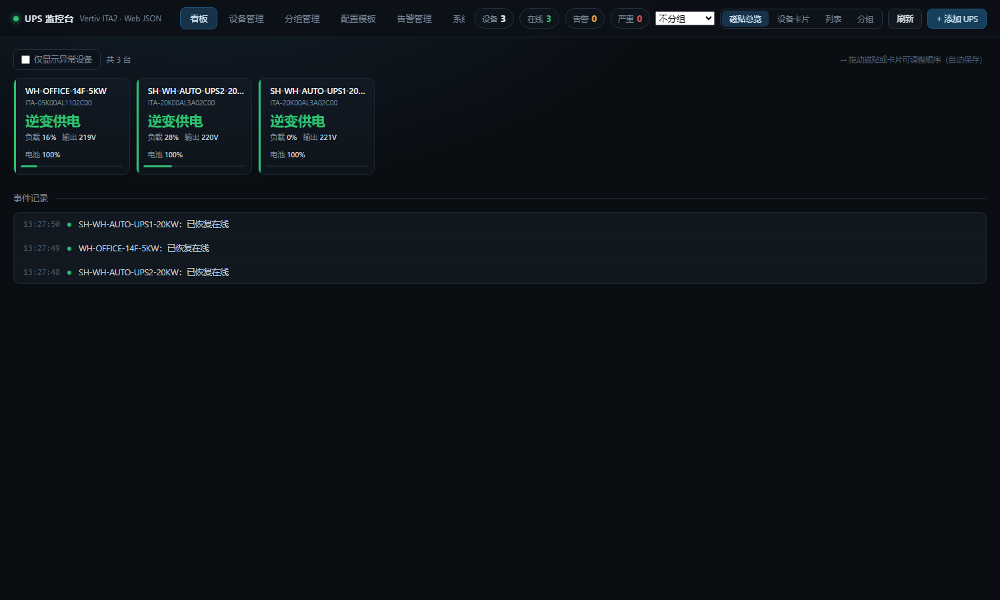

<div align="center">

# UPS Monitor · ups-monitor

A lightweight monitoring system for Vertiv Liebert ITA2 series UPS units, collecting runtime data through the device's built-in web JSON endpoints

<p>
  <a href="https://github.com/hyx805123/ups-web-json-monitor/releases/latest"></a>
  <a href="https://github.com/hyx805123/ups-web-json-monitor/actions/workflows/ci.yml"></a>
  
  <a href="LICENSE"></a>
  
</p>

Single process · Zero third-party dependencies · Validated at 30–40 devices

[Overview](#overview) · [Features](#features) · [Architecture](#architecture) · [Quick start](#quick-start) · [REST API](#rest-api) · [Release history](#release-history)

</div>

---

## Overview

This project provides operational monitoring for data-centre UPS units and currently targets the **Vertiv Liebert ITA2** series.

The system does not deploy an SNMP collector and does not maintain MIB template mappings. It reads data directly from the JSON endpoints exposed by the device's **built-in web server**. Onboarding a device requires three inputs: **IP address, web account, web password**. Supply-state enumerations, battery state and sensor capabilities are all reported by the device itself.

### Rationale: web JSON instead of SNMP

The project initially used the commercial collector **Vertiv Power Insight** together with `VERTIV-ITA2-MIB`. Measurements on production hardware showed the following gaps in the SNMP channel:

| Metric | SNMP channel | Built-in web JSON |
|---|---|---|
| Overall supply state | Template lacks a `deviceToNormal` mapping; enumeration is always `1` (other) | Inverter / bypass / combined supply, using the device's own definitions |
| Ambient temperature | OID returns the sentinel `65535` (0xFFFF), parsed as 6553.5 °C | `envTemp` returns the real value (22.1 °C measured) |
| Battery temperature / humidity | No corresponding OID | Capability declared via `HasTempSensor` / `HasHumiSensor`; reported as unsupported when absent |
| Firmware version | Node does not exist in the MIB tree | Provided by the About page nameplate table |
| Input current, line voltage, phases B and C | Missing | Fully available |
| Energy counters, apparent power, crest factor | Missing | Fully available |

Conclusion: the web JSON channel provides materially more complete data, and its enumerations originate from the device's own implementation, removing the entire class of template-mapping errors. The project therefore uses web JSON exclusively; the SNMP channel is no longer a data source.

### Trademarks and disclaimer

This is an independent tool that communicates only through the device's built-in web interface. It is not affiliated with, endorsed by, or supported by Vertiv.

Vertiv, Liebert and ITA2 are trademarks of Vertiv Co. and are referenced solely to identify the supported models.

---

## Features

### Monitoring and presentation

- **Four dashboard views**: tile overview, device cards, list, grouped panels; selection is persisted server-side
- **Tile overview**: 8 × 5 layout showing 40 devices on a single screen, each with supply state, load, output voltage, battery capacity and a load bar
- **Device cards**: full metric grid with output-voltage and load trend lines and hover readout
- **List view**: 15 columns, sortable headers and a compact mode
- **Grouped view**: dynamic grouping by model, site or status, plus static custom groups with drag-to-assign
- **Device detail**: complete input, output, bypass, load and battery metrics, threshold verdicts and multi-track trend charts
- **Two themes**: dark (Tech Black) and light (Classic White), implemented with semantic colour variables and persisted server-side
- **Event drawer**: persistent entry in the bottom-right corner with unread badge, available from any view

### Data and storage

- **Permanent history retention**: per-device, per-day JSONL shards, downsampled at query time
- **Range queries**: presets from 1 hour to 90 days, custom start and end times, or the entire history
- **Range statistics**: mean and peak load, minimum battery capacity, discharge count and cumulative duration, bypass duration, alarm samples, ambient temperature
- **Per-phase history**: three-phase models record input/output voltage and output current for phases A, B and C, charted as three series
- **CSV export**: 27 columns, UTF-8 BOM with CRLF line endings, directly readable in Excel, up to 200,000 rows per export
- **Cold-data archiving**: shards older than the configured threshold are compressed to `.jsonl.gz` (measured ratio about 18.8:1); each file is written to a temporary path and read back for byte-level verification before the original is removed
- **Capacity retention**: when disk usage reaches the configured limit (60 GB by default), whole days are removed from the oldest data until usage falls to 90% of the limit; the current day is never removed. A "keep last N days" mode is also available

### Alerting and notification

- **Rule engine**: 20 field types, 6 operators, cooldown, repeat notification and recovery notification
- **Two delivery channels**: WeCom group robot (markdown) and SMTP email (25 / 587 STARTTLS / 465 implicit TLS)
- **Metric thresholds**: 9 metrics with three severity levels derived from vendor documentation and national standards; violations recolour values, trend lines, card bars and status badges
- **Delivery log**: every push is recorded for channel troubleshooting

### Devices and asset records

- **Device management**: create, read, update, delete, bulk assign, enable, disable and delete, with search and filtering
- **Asset fields**: site, commissioning date, integrator, model, serial number, tags, notes
- **Identity auto-discovery**: model, serial number, firmware version, MAC address and warranty expiry can be read from the device; reading only fills empty fields and never overwrites manual input
- **Configuration templates**: pre-fill common parameters such as polling interval, site, integrator, account and port
- **Connection self-healing**: automatic reconnection after network interruption with a recorded recovery event; during backoff only TCP probes are issued, preserving scarce device sessions; the UI shows a countdown to the next retry
- **Network diagnostics**: detects when traffic to the target subnet resolves only through the default route and reports a missing VPN or zero-trust tunnel instead of a device failure

### Engineering properties

- **Zero third-party dependencies**: Node.js standard library only, including a self-implemented HTTP/1.0 client and SMTP client
- **Rollback build**: `upsmon-v1-minimal/` retains only collection and the dashboard
- **Credential redaction**: device passwords and channel secrets are masked in API responses; empty values on write preserve the stored credential

---

## Screenshots



*Captured from a production deployment; device names and IP addresses are masked.*

---

## Architecture

### Deployment model

A single Node.js process hosting the HTTP server, collection scheduler, configuration centre, alert engine and front-end assets. Data is persisted as files; no external database is required.

### Module layout

| Module | Responsibility |
|---|---|
| `server.js` | HTTP server, collection scheduling, configuration centre, alert dispatch, REST routing |
| `lib/http10.js` | Raw HTTP/1.0 client for lwIP compatibility |
| `lib/vertiv.js` | ITA2 driver: login, session management, fetching, normalisation, identity discovery |
| `lib/store.js` | Device registry persistence with atomic writes |
| `lib/settings.js` | Configuration centre: groups, templates, channels, rules, thresholds, UI preferences |
| `lib/grouping.js` | Grouping engine for dynamic and static groups |
| `lib/alerts.js` | Rule evaluation and notification dispatch |
| `lib/smtp.js` | Minimal SMTP client |
| `lib/thresholds.js` | Threshold definitions and evaluation |
| `lib/history.js` | Shard I/O, range pruning, downsampling and statistics |
| `lib/archive.js` | Cold-data compression and verification |
| `lib/retention.js` | Capacity retention and event-log compaction |
| `public/index.html` | Single-file front end containing all styles and scripts |

### Device-side constraints

The following constraints stem from the device firmware and directly determine the implementation:

| Constraint | Detail | Mitigation |
|---|---|---|
| HTTP/1.0 only | The built-in web server runs on lwIP 1.3.1; HTTP/1.1 keep-alive connections are reset, presenting as session expiry or a redirect to the login page | Self-implemented HTTP/1.0 client with `Connection: close` and one connection per request |
| Very few web sessions | The login page enforces "Too many users on-line"; in testing only 1 of 5 consecutive logins yielded a usable session | Log in once and reuse the SID; call `/SignOut.cgi` before re-authenticating; login cooldown and exponential backoff |
| Sensor capability declared by device | Without optional temperature or humidity sensors the interface returns sentinel values | Evaluated against `HasTempSensor` / `HasHumiSensor`; the UI reports the metric as unsupported |
| Phase and line voltage differ | `L_N_Volt` is phase-to-neutral (220 V for both single- and three-phase); `L_L_Volt` is line-to-line (380 V three-phase) | Threshold evaluation uses the phase voltage consistently; line voltage is blanked for single-phase models |

> Session exclusivity: opening the device web UI manually displaces the collector session, which is re-established on the next cycle. Do not run two monitoring instances against the same device.

---

## Quick start

### Requirements

| Item | Requirement |
|---|---|
| Runtime | Node.js ≥ 18; no `npm install` required |
| Network | Reachability to the UPS built-in web server (HTTP port 80) |
| Credentials | Device web account and password |

### Run

```bash
# Windows one-click script
upsmon/start.bat

# Command line
node upsmon/server.js
```

Open **http://localhost:8686**.

### Add a device

Select **+ Add UPS** in the top-right corner and provide:

| Field | Description |
|---|---|
| Name / IP / port | Required |
| Web account / web password | Required; the password is used only for collection and is never returned by the API |
| Site | Used for site grouping and reporting |
| Commissioning date | Asset record field |
| Integrator | Asset record field |
| Model / serial number | Optional; read from the device when left blank |

Use **Test connection** to verify, then save. Collection begins immediately without restarting the service.

### Environment variables

| Variable | Default | Purpose |
|---|---|---|
| `PORT` | `8686` | HTTP listen port |
| `UPS_DATA_DIR` | `./upsmon/data` | Data directory, for isolating multiple instances |

```bash
PORT=9000 UPS_DATA_DIR=/var/lib/upsmon node upsmon/server.js
```

---

## Development and testing

Two dependency-free checks ship with the repository; CI invokes the same entry points.

```bash
npm test          # static check + smoke test
npm run check     # static check only
npm run smoke     # smoke test only
```

| Command | Scope |
|---|---|
| `node upsmon/tools/ci-check.js` | Runs `node --check` over every `.js` file, compiles the inline scripts in `index.html`, and verifies `<style>` tags are balanced and not duplicated |
| `node upsmon/tools/smoke.js` | Starts the server against a temporary `UPS_DATA_DIR` and verifies `/api/brand`, `/api/state`, `/api/history` and the static index before exiting |

The smoke test uses an isolated temporary data directory: it never reads or writes `upsmon/data/` and never contacts a real device, so it runs offline.

CI is defined in [`.github/workflows/ci.yml`](.github/workflows/ci.yml). Static checks run on Node.js 18, 20 and 22; the smoke test additionally runs once on Windows to cover `start.bat` and path handling.

---

## Repository layout

```
.
├─ README.md                 Project documentation (Chinese)
├─ README.en.md              Project documentation (English)
├─ CHANGELOG.md              Release notes
├─ package.json
├─ LICENSE
├─ screenshots/              Documentation images
├─ .github/workflows/ci.yml  Continuous integration: static check and smoke test
├─ docs/
│  ├─ AUTH-DESIGN.md         Authentication and RBAC design (not implemented)
│  └─ CMDB-ROADMAP.md        Feature backlog and engineering debt
├─ upsmon/                   Full edition
│  ├─ server.js              HTTP server, scheduler, config centre, alerting, REST API
│  ├─ lib/                   Driver, storage, alerting, history and archive modules
│  ├─ public/index.html      Single-file front end
│  ├─ tools/                 ci-check.js, smoke.js, test-data generator
│  ├─ brand.local.json       Local branding (git-ignored; footer hidden when absent)
│  ├─ data/                  Runtime data (git-ignored, contains credentials)
│  └─ start.bat
└─ upsmon-v1-minimal/        Minimal edition (rollback build)
```

---

## Configuration

### Default thresholds

Thresholds are evaluated using phase voltage and are derived from vendor documentation and national standards. They can be edited under **Alert Management → Metric Thresholds** and reset to defaults.

| Metric | Normal → Warning | Warning → Critical | Basis |
|---|---|---|---|
| Output voltage | ±5% | ±10% | GB/T 7260 steady state ±1%; GB 50174 ±7% at the load; GB/T 12325 |
| Input voltage | ±10% | outside 176–288 V | ITA2 manual input range |
| Bypass voltage | ±20% | outside device range | ITA2 manual bypass −40% to +20% |
| Line voltage (AB) | ±5% | ±10% | 380 V three-phase nominal; not applicable to single-phase |
| Output current | 85% of rated | 100% of rated | Manual overload 105–125% for 10 min |
| Load | 70% | 85% | Optimal sustained load 40–70% |
| Battery capacity | 50% | 20% | Deep discharge accelerates battery ageing |
| Output frequency | ±0.5 Hz | ±2 Hz | GB 50174 50 Hz ±0.5 Hz |
| Ambient temperature | 30 °C | 35 °C | ITA2 0–40 °C without derating |
| Phase imbalance | 1% | 2% | GB/T 15543 ≤2% |

Threshold verdicts are also exposed as alert-rule fields (for example `outputVoltageLevel = crit`).

### Collection and storage policy

| Endpoint | Frequency | Content |
|---|---|---|
| `/_com/home/home.json` | Every cycle (10 s by default) | Supply state, voltages, currents, frequency, load, battery, temperature, alarm counts, model |
| `/_com/status/{input,output,load,bypass,battery}.json` | Every 3 cycles (about 30 s) | Power factor, energy counters, apparent power, crest factor, sensor capability |

- History: `data/history/<device-id>/<YYYY-MM-DD>.jsonl`, one sample per line, retained permanently
- In-memory buffer: the most recent 3600 samples for fast dashboard rendering
- Event log: `data/history/events.jsonl`, retained permanently
- Archive: shards older than the configured threshold are compressed to `.jsonl.gz` and decompressed transparently on read
- Retention: whole days removed from the oldest data once the capacity limit is reached; the current day is never removed

---

## REST API

| Method | Path | Description |
|---|---|---|
| GET | `/api/state?groupBy=` | All device state with trend series, events and grouped views |
| GET | `/api/settings` | Full configuration centre (credentials redacted) |
| GET/PUT | `/api/thresholds` | Read and update metric thresholds |
| POST | `/api/thresholds/reset` | Restore default thresholds |
| GET/POST | `/api/devices` | List and create devices |
| PUT/DELETE | `/api/devices/:id` | Update or delete a device (also removes its history) |
| POST | `/api/devices/batch` | Bulk assign, enable, disable or delete |
| POST | `/api/devices/reorder` | Persist drag order; optional `targetGroupId` also assigns a group |
| POST | `/api/devices/:id/poll` | Trigger an immediate poll |
| POST | `/api/devices/:id/alert-test` | Evaluate rules as if the device were offline and dispatch |
| GET | `/api/history/:id?range=1h\|6h\|24h\|7d\|30d\|90d&points=600` | History series and range statistics (`stats=0` disables statistics) |
| GET | `/api/history/:id?from=&to=&points=` | Custom range query (millisecond timestamps) |
| GET | `/api/history/:id/export?from=&to=` | CSV export (27 columns, UTF-8 BOM, up to 200,000 rows) |
| GET | `/api/history` | Coverage overview per device (days, first and last day, disk usage) |
| GET | `/api/events?limit=&from=&to=` | Persisted event log, filterable by range |
| GET/POST | `/api/groups` | Group configuration |
| GET/POST | `/api/templates` | Configuration templates |
| GET/POST | `/api/channels` | Notification channels (`POST /api/channels/:id/test` sends a test message) |
| GET/POST | `/api/rules` | Alert rules |
| POST | `/api/test` | Test a device connection without saving |

---

## Device endpoints (ITA2)

| Endpoint | Content |
|---|---|
| `POST /SignIn.cgi` | Form `UserName` / `Pswd` → `Set-Cookie: SID=<hex>` |
| `GET /SignOut.cgi` | Log out; the previous SID is invalidated immediately |
| `GET /_com/home/home.json` | Overview: supply state, voltage, current, frequency, load, battery, ambient temperature, model, alarm counts |
| `GET /_com/status/input.json` | Input power factor, energy counter |
| `GET /_com/status/output.json` | Output energy counter |
| `GET /_com/status/load.json` | Apparent power, crest factor |
| `GET /_com/status/bypass.json` | Bypass parameters |
| `GET /_com/status/battery.json` | Battery group parameters, cabinet temperature, sensor presence flags |
| `GET /_com/_infor/infor.json` | Device IP address and UPS time |
| `GET /CH/about/about.shtml` | Nameplate data: serial number, model, firmware version, MAC address, warranty expiry, uptime |

Enumeration meanings are taken from the device's own front end:

- Supply state: `0` no supply / `1` bypass / `2` inverter / `3` combined
- Battery state: `0` no battery / `1` float / `2` equalise / `3` discharging / `4` full / `5` idle / `6` self-test

---

## Release history

| Version | Summary |
|---|---|
| 1.0.0 | First usable release: HTTP/1.0 client, ITA2 driver, tile dashboard, 10-second polling |
| 1.1.0 | Form guard against accidental dismissal; automatic model and serial discovery; connection test reuses the collection session |
| 1.2.0 | Event log moved to a floating entry and drawer; dark and light themes; local branding support |
| 1.2.1 | Fixed duplicate style tags that broke theme variables |
| 1.2.2 | Serial number now parsed from the About page nameplate table, as the JSON endpoints do not expose it |
| 1.3.0 | History explorer added; shard pruning by date reduced a 1-hour query from 404 ms to 10 ms |
| 1.3.1 | Fixed large ranges being truncated by the in-memory buffer (7-day and 30-day ranges returned only the last 10 hours) |
| 1.4.0 | Per-phase voltage and current persisted for three-phase models, with three-series charts; CSV export extended to 27 columns |
| 1.5.0 | Cold-data gzip archiving, capacity retention and event-log compaction |
| 1.5.1 | Three-phase metrics hidden for single-phase models; phase count written back to the device registry |

See [`CHANGELOG.md`](CHANGELOG.md) for the complete record.

---

## Known limitations

| Area | Limitation |
|---|---|
| Device compatibility | Model and serial number depend on row ids in the About page nameplate table; firmware that renames those ids will read as blank |
| Performance | History queries are not indexed; a single-day range still parses that day's shard sequentially (about 8,600 rows) |
| Hardware | Battery temperature and humidity require optional sensors and are reported as unsupported when absent |
| Security | No authentication is implemented; the console is open on the LAN. See [`docs/AUTH-DESIGN.md`](docs/AUTH-DESIGN.md) |
| Security | The collection path uses plain HTTP, and credentials are stored in plaintext in `data/devices.json` (redacted in API responses). Intended for trusted networks only |
| Operations | No service installation or EXE packaging; the service must be started manually |
| Operations | No log files; output goes to the console only, with no severity levels or rotation |
| Backup | Archiving and retention operate on local disk only, with no off-host copy; retention is destructive and irreversible |

---

## Roadmap

See [`docs/CMDB-ROADMAP.md`](docs/CMDB-ROADMAP.md) for the complete backlog across seven categories, prioritised into three tiers. As of v1.5.1 there are **41 open items** (A7 · B6 · C6 · D7 · E6 · F4 · G5) plus 6 engineering debts under category H (missing-data gaps in charts, unindexed history, downsampling loss, About-page parsing risk, plaintext credentials, no off-host backup).

**Tier 1**: service installation and packaging · configuration and data backup · bulk import and export · minimal authentication · role-based credential visibility · maintenance-window suppression

**Tier 2**: warranty expiry reminders · statistical reporting · battery health assessment · alert ticketing · WeCom application messages · role segmentation · audit log

**Tier 3**: inspection workflows · energy analytics · predictive maintenance · rack location mapping · wall-display mode

---

## Documentation

| Document | Content |
|---|---|
| [`CHANGELOG.md`](CHANGELOG.md) | Release notes in Keep a Changelog format |
| [`docs/AUTH-DESIGN.md`](docs/AUTH-DESIGN.md) | Authentication and RBAC design |
| [`docs/CMDB-ROADMAP.md`](docs/CMDB-ROADMAP.md) | Feature backlog and engineering debt |
| [`upsmon/README.md`](upsmon/README.md) | Full-edition module reference (Chinese) |
| [`upsmon-v1-minimal/README.md`](upsmon-v1-minimal/README.md) | Minimal edition and rollback guide (Chinese) |

---

## License

[MIT](LICENSE) © 2026 UPS Monitor contributors
