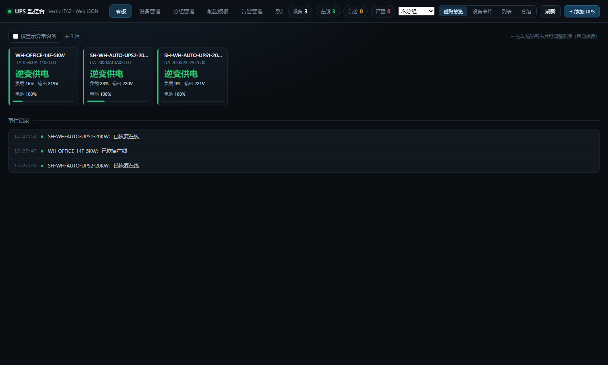
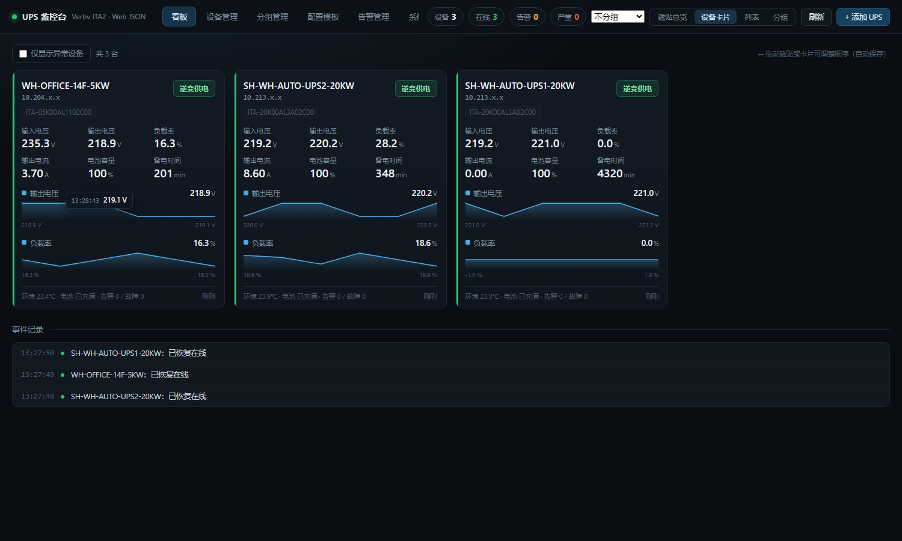
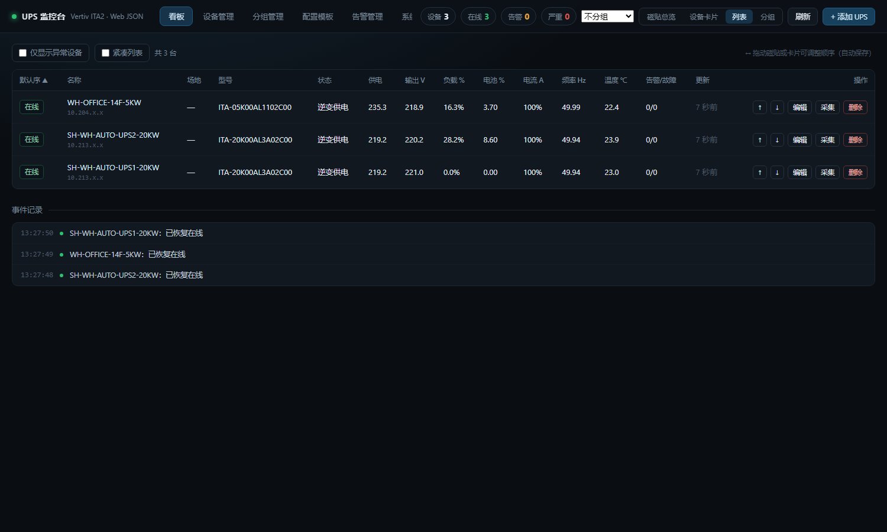
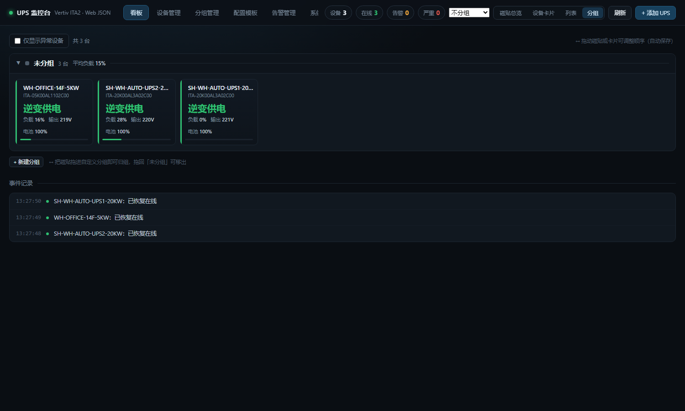
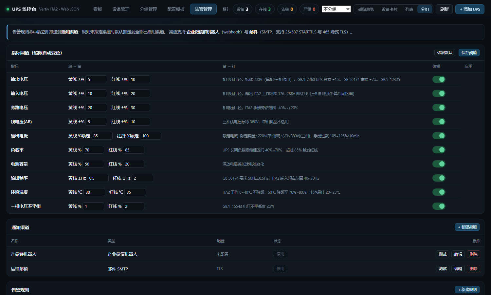
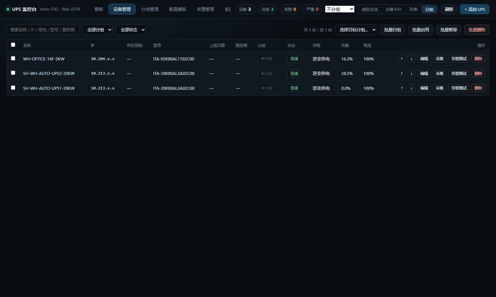
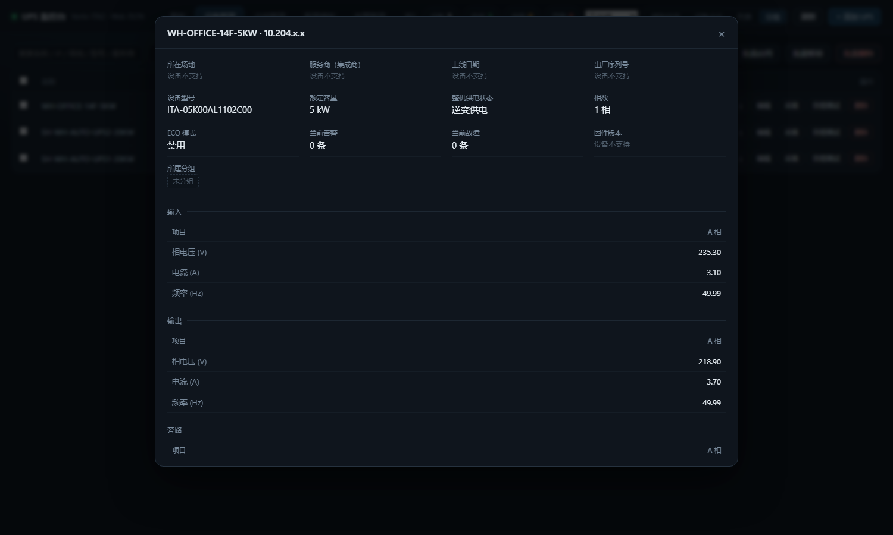

<div align="center">

# UPS 监控台 · ups-monitor

**直接轮询 UPS 内建 Web 的 JSON 接口，绕开 SNMP 的自建 UPS 监控系统**

Node.js 单进程 · 零第三方依赖 · 支持 30~40 台设备规模

[快速开始](#快速开始) · [开发历程](#开发历程) · [技术要点](#技术要点) · [文档](#文档)

</div>

---

## 这是什么

针对 **Vertiv Liebert ITA2** 系列 UPS 的自建监控平台。

不部署 SNMP 采集器、不做 MIB 模板映射，直接调用设备**内建 Web 服务**暴露的 JSON 接口取数。
新增一台设备只需要录 **IP + 网页账号 + 密码**，其余配置（供电状态枚举、电池状态、传感器能力）
全部由设备自身返回。

> ⚠️ 本项目为独立工具，通过设备自带 Web 接口通信，与 Vertiv 无隶属、认可或支持关系。
> Vertiv / Liebert / ITA2 为 Vertiv Co. 的商标。

### 界面一览

| 磁贴总览（40 台一屏） | 设备卡片（趋势线 + 悬停读数） |
|---|---|
|  |  |

| 趋势线悬停读数 | 列表视图（可排序 / 紧凑） |
|---|---|
|  |  |

| 分组折叠 | 指标阈值配置 |
|---|---|
|  |  |

| 设备管理（台账字段） | 详情 + 历史折线图 |
|---|---|
|  |  |

*（截图为实际运行环境，IP 已打码）*

---

## 为什么要自己做

一开始是用商业软件 **Vertiv Power Insight** 采集这些 UPS，装好后发现三个数据问题：

| 现象 | 根因 |
|---|---|
| 供电状态恒显示 `1`（other） | 设备 MIB 里这个枚举**没有映射规则**，模板缺 `deviceToNormal` |
| 温度显示 6553.5℃ | 对应 OID 返回 `65535`(0xFFFF)，是**无传感器的哨兵值**被当真实读数 |
| 固件版本读不出来 | 整棵 MIB 树里**根本不存在**固件 OID |

逐项排查后发现：**这三件事都不是 SNMP 的问题，而是 SNMP 这条路本身给不出这些数据。**
于是转向设备内建的 Web 接口——同一台设备，它自己网页上明明显示着"逆变供电""环境温度 22.1℃"。

对比结果（同一台设备实测）：

| 指标 | SNMP | 内建 Web JSON |
|---|---|---|
| 整机供电状态 | 枚举无映射，恒为 `1` | ✅ 逆变供电 / 旁路供电 / 联合供电（设备自带中文定义） |
| 环境温度 | `65535` → 6553.5℃ | ✅ 22.1℃ 真实值 |
| 电池温度 / 湿度 | 无对应 OID | ✅ 设备自述 `HasTempSensor=0` → 界面显示"设备不支持" |
| 固件版本 | 树里不存在 | ❌ Web 端也没有 → 判定为**设备不支持** |
| 输入电流 / 线电压 / 三相 B、C | 缺失 | ✅ 都有 |
| 累计电能 / 视在功率 / 峰值因数 | 缺失 | ✅ 都有 |

结论：**JSON 通道的数据完整度明显高于 SNMP**，而且枚举含义直接来自设备自身的前端代码，
不存在"模板映射写错"这类问题——这不是绕过 SNMP，是选了一条更靠谱的路。

---

## 开发历程

这一节记录这个项目从"装个软件发现读数不对"到"能长期盯着 30 多台设备"的完整过程，
包括走过的弯路。

### 阶段 0 · 起点：商业软件部署与三个异常

部署 Vertiv Power Insight（InstallAnywhere 自解压包 + 内置 Zulu JDK 8），
安装过程被企业安全策略拦在 `wmic.exe` 上，最后靠一个纯 ASCII 的 `install-power-insight.bat`
让用户在 WorkBuddy 之外双击执行才装上。

装完立刻发现三个读数异常（供电状态、温度、固件版本），于是开始逐层排查。

### 阶段 1 · 排查 SNMP：把 MIB 树走了一遍

- 用 Power Insight 自带的 `snmpwalk` 把设备 `.13400.2.54` 下的 64 个 OID 加完整 MIB-II 全量走了一遍
- 确认 `st_sys_upsOutputSource` 的模板里**确实没有 `deviceToNormal` 映射**
- 确认温度 OID `.2.5.8/.2.5.9` 返回 `65535` = 0xFFFF
- 确认整棵树里**没有固件版本 OID**，`sysDescr` 只是 "LwIP SNMP Application"

也尝试过直接改 MongoDB（`monitoringdefinitions` / `monitoredobjects`）补映射并重启服务，
但引擎拿的是**加设备时冻结的配置快照**，直接改库不会触发 Hazelcast 事件，映射始终不生效——
这条路走不通，成为转向 Web 接口的契机。

### 阶段 2 · 转向：直接抓设备内建 Web

用 `POST /SignIn.cgi` 拿到 `SID` 会话后读 `home.json`，第一眼就看到设备自己报告的
`upsSupplyState: "2"`、`envTemp: "22.1"`——**这些 SNMP 给不出的数据，设备一直都在报。**

但紧接着撞上两个硬骨头：

**① lwIP 1.3.1 只支持 HTTP/1.0。**
Node 的 `fetch`（undici，HTTP/1.1 + keep-alive）和 PowerShell 的 `Invoke-WebRequest`
都会被对端直接 RST，症状伪装成"登录成功但 SID 无效""页面跳回登录页"——
当时误判成"设备会话表满了"，绕了不少弯路。
最终解法是手写裸 TCP 客户端：固定 `Connection: close`，一请求一连接。见 `lib/http10.js`。

**② 网页会话极稀缺且登录被限流。**
设备登录页硬编码着提示语 **"Too many users on-line. Please wait"**。
实测连登 5 次只有 1 次真正建立可用会话。于是定下策略：**登录一次长期复用 SID**，
重登前先 `/SignOut.cgi` 释放旧会话，驱动内置 30 秒冷却 + 失败指数退避。

### 阶段 3 · 最小可用版本

写出裸 HTTP 客户端 + ITA2 驱动 + 单页看板，10 秒一轮采集稳定跑通。
此时已经能读到逆变供电、环境温度、电池容量、备电时间、三相电压电流。

### 阶段 4 · 从"能看"到"能管"

按需求补齐：设备增删改查、**分组**（型号/场地/状态动态分组 + 自定义静态分组）、
**配置模板**（批量录入预填公共参数）、
**告警引擎**（规则评估 + 冷却/重复/恢复通知 + 企微 webhook + 手写 SMTP 客户端）。

告警渠道是零依赖手写的：企微用 `https.request` 发 markdown，SMTP 自己实现了
EHLO / STARTTLS / AUTH PLAIN→LOGIN 回退 / DATA，25、587、465 三种端口都支持。

### 阶段 5 · 历史数据永久留存

原先历史只放内存环形缓冲，重启即失。改成按设备 + 日期分片 JSONL 落盘，
**永久保留**；详情页加多轨折线图（输出电压 / 输入电压 / 负载率 / 电池容量 / 环境温度共享时间轴），
支持 1 小时到 30 天范围切换，鼠标移动出十字线读数。

### 阶段 6 · 指标阈值与超限变色

需求是"电流电压超阈值要不同颜色"。阈值不能拍脑袋，于是把**官方手册参数**和**国家标准**都查实了：

- Vertiv ITA2 手册：输入范围 176~288V（单相满载）、输出稳态 ±1%、旁路 -40%~+20%、
  过载 105%~125%/10min、工作温度 0~40℃（50℃ 降额至 70~80%）
- GB/T 7260-2016《UPS》：稳态输出电压偏差 ±1%（单机）
- GB 50174-2017《数据中心设计规范》：末端电压偏差 ±7%、频率 50Hz±0.5Hz
- GB/T 12325-2008《电能质量 供电电压偏差》：220V 单相 +7%/-10%
- GB/T 15543-2008：电压不平衡度 ≤2%

9 类指标三档判定，超限同时影响卡片色条、状态徽章、数值颜色、趋势线颜色、提示语和设备严重级别，
每条阈值在界面上都标注了依据来源。

> 这里踩过一次自己的坑：最初把三相 20KW 的**相电压 220V** 拿去跟**线电压标称 380V** 比，
> 导致两台完全正常的设备被判成红线。设备 JSON 里 `L_N_Volt` 是相对中性点的相电压，
> 单相和三相都是 220V，线电压在 `L_L_Volt`——口径必须统一。

### 阶段 7 · 面向 30+ 台设备

设备规模预估会到 30~40 台，原来的卡片网格要滚 8 屏。做了四视图切换：
**磁贴总览**（40 台一屏看完）、**设备卡片**、**列表**（点表头排序 / 紧凑模式）、**分组折叠**。

同时发现一个只有规模化才会暴露的性能问题：前端每 5 秒对**每台设备**发一次 history 请求，
40 台就是 40 个请求 + 40 次磁盘读。改成服务端随 `/api/state` 一起下发趋势序列，
**40 台实测 50 KB / 96 ms**。

### 阶段 8 · 拖拽排序，以及两个被自己的测试骗了的 bug

加拖拽后用户反馈"拖不动"。排查出三个原因，其中两个值得记录：

**① 容器选择器写死成 `.tiles`，而卡片视图的容器是 `.grid`** ——
所以磁贴能拖、卡片拖不动。用户一句"磁贴可以，卡片不行"直接定位了真凶。

**② 5 秒自动刷新会打断拖动** ——
`refresh()` 每次 `innerHTML` 重建看板，真人拖动慢，拖到一半撞上刷新点，
正在拖的元素被从 DOM 移除，拖动直接断掉。改成拖动期间跳过重绘。

这里有个教训：**我最初的自动化测试是通过的**，因为 Playwright 的 `mouse.move` 14 步在 1 秒内完成，
**恰好躲过了 5 秒刷新点**。改用慢速拖动（每次移动间隔 700ms、全程 7~8 秒）后立刻复现。
测试脚本比人快，是这类 UI bug 的隐形遮羞布。

**③ 卡片文字被鼠标选中抢占** → 加 `user-select:none`。

### 阶段 9 · 工程化

补齐 `.gitignore`（设备密码、webhook、口令一律不进仓库）、`package.json`、
`LICENSE`、示例配置、**可回退的最简版本**（`upsmon-v1-minimal/`）、
以及本文档。

### 一句话总结

这个项目真正的转折点不是"用什么协议"，而是**回到设备自己去看它到底在报什么**——
SNMP MIB 是一份二手的、厂商自己都填不全的翻译，而设备内建的 JSON 是它自己的第一手数据。
剩下的大部分工作，都是在跟一台只认 HTTP/1.0、会话只有一两个的嵌入式设备斗智斗勇。

---

## 核心特性

- **零第三方依赖** —— 只有 Node.js 标准库，含手写的 HTTP/1.0 客户端与 SMTP 客户端
- **四种看板视图** —— 磁贴总览 / 设备卡片 / 列表 / 分组折叠，顶栏一键切换并持久化
- **动态 + 静态分组** —— 按型号、场地、状态自动归类；自定义分组支持拖拽归组
- **告警引擎** —— 20 类字段 × 6 种比较符，冷却 / 持续重复 / 恢复通知
- **双通道推送** —— 企业微信群机器人（markdown）+ 邮件 SMTP（25/587/465）
- **指标阈值** —— 9 类指标三档判定，依据源自官方手册与国标，超限全链路变色
- **历史永久留存** —— 按天分片 JSONL，支持 1 小时 ~ 30 天范围的多轨折线图
- **台账字段** —— 所在场地、上线日期、服务商（集成商）、型号、序列号、标签、备注
- **拖拽排序与归组** —— 桌面鼠标拖拽 + 触摸长按，另提供 ↑/↓ 按钮兜底
- **断线自愈** —— 网络恢复后自动重连并补记"已恢复在线"事件
- **可回退** —— 附带只保留采集与看板的最简版本，主版本出问题可随时切换

---

## 快速开始

### 环境要求

- Node.js ≥ 18（仅需 Node.js，**不需要 npm install**）
- 与 UPS 内建 Web（HTTP 80 端口）网络可达
- 设备网页账号密码（默认 `user` / 见设备面板）

### 运行

```bash
# 方式一：一键脚本（Windows）
upsmon/start.bat

# 方式二：命令行
node upsmon/server.js
```

打开 **http://localhost:8686**

### 添加设备

界面右上角 **「+ 添加 UPS」**：

| 字段 | 说明 |
|---|---|
| 名称 / IP / 端口 | 必填 |
| 网页账号 / 网页密码 | 必填，密码仅用于采集，API 永不回传明文 |
| 所在场地名称 | 用于按场地分组 |
| 上线日期 | 台账字段 |
| 服务商（集成商） | 台账字段 |
| 型号 | 留空则自动读取设备自报型号 |

点「测试连接」确认能读到数据后保存，**立即开始采集，无需重启服务**。

### 环境变量

| 变量 | 默认 | 说明 |
|---|---|---|
| `PORT` | `8686` | 服务端口 |
| `UPS_DATA_DIR` | `./upsmon/data` | 数据目录（多实例并存时用） |

```bash
PORT=9000 UPS_DATA_DIR=/var/lib/upsmon node upsmon/server.js
```

---

## 项目结构

```
.
├─ README.md                 本文档
├─ README.en.md              English version
├─ package.json
├─ LICENSE
├─ screenshots/              README 用图
├─ docs/
│  ├─ AUTH-DESIGN.md         身份认证与权限管理设计（未上线）
│  └─ CMDB-ROADMAP.md        CMDB 功能扩展清单
├─ upsmon/                   完整版
│  ├─ server.js              HTTP 服务 + 采集调度 + 配置中心 + 告警 + REST API
│  ├─ lib/
│  │  ├─ http10.js           裸 HTTP/1.0 客户端（为 lwIP 定制）
│  │  ├─ vertiv.js           ITA2 驱动：登录、抓取、归一化
│  │  ├─ store.js            设备清单持久化
│  │  ├─ settings.js         配置中心：分组/模板/告警/阈值
│  │  ├─ grouping.js         分组引擎
│  │  ├─ alerts.js           告警规则引擎 + 企微 + 邮件
│  │  ├─ smtp.js             极简 SMTP 客户端
│  │  ├─ thresholds.js       指标阈值定义与判定
│  │  └─ history.js          历史分片落盘与降采样查询
│  ├─ public/index.html      前端（单文件，含全部样式与脚本）
│  ├─ tools/                 压测数据生成
│  └─ data/                  运行时数据（git 忽略，含密码）
└─ upsmon-v1-minimal/        最简版（回退备用）
```

---

## 技术要点

### ① 必须用 HTTP/1.0，不能用 keep-alive

ITA2 内建 Web 跑在 **lwIP 1.3.1** 上，只支持 HTTP/1.0。
HTTP/1.1 客户端会被对端直接 RST，症状伪装成"会话失效"。
`lib/http10.js` 手写请求行、固定 `Connection: close`、一请求一连接。

### ② 会话极稀缺，登录被限流

设备登录页内置提示 **"Too many users on-line. Please wait"**。
策略：登录一次长期复用 SID；重登前先 `/SignOut.cgi`；30 秒登录冷却；失败指数退避。

> 副作用：人工打开 UPS 网页会挤掉监控会话（监控会自动恢复）；
> 也**不要同时开两个实例连同一台 UPS**，它们会互相抢会话。

### ③ 传感器能力由设备自己声明

`/_com/status/battery.json` 带 `HasTempSensor` / `HasHumiSensor` 标志位。
界面据此显示"设备不支持"，而不是把 `-100.0` 这类无效哨兵当真实读数。

### ④ 电压口径

`L_N_Volt` 是**相电压**（单相/三相都是 220V），`L_L_Volt` 才是线电压（三相 380V）。
所有阈值判定必须统一用相电压口径。

---

## 指标阈值默认值

| 指标 | 绿 → 黄 | 黄 → 红 | 依据 |
|---|---|---|---|
| 输出电压 | ±5% | ±10% | GB/T 7260 UPS ±1%；GB 50174 末端 ±7%；GB/T 12325 |
| 输入电压 | ±10% | 超出 176~288V | ITA2 手册输入范围 |
| 旁路电压 | ±20% | 超出设备范围 | ITA2 手册旁路 -40%~+20% |
| 线电压(AB) | ±5% | ±10% | 三相标称 380V，单相不适用 |
| 输出电流 | 85% 额定 | 100% 额定 | 手册过载 105%~125%/10min |
| 负载率 | 70% | 85% | UPS 长期负载率最佳区间 40%~70% |
| 电池容量 | 50% | 20% | 深放电显著加速电池老化 |
| 输出频率 | ±0.5Hz | ±2Hz | GB 50174 频率 50Hz±0.5Hz |
| 环境温度 | 30℃ | 35℃ | ITA2 0~40℃ 不降额，50℃ 降额 |
| 三相不平衡 | 1% | 2% | GB/T 15543 ≤2% |

阈值可在「告警管理 → 指标阈值」直接修改，也能一键恢复默认。

---

## REST API

| 方法 | 路径 | 说明 |
|---|---|---|
| GET | `/api/state?groupBy=` | 全部设备状态（含趋势序列）+ 事件 + 分组视图 |
| GET | `/api/settings` | 配置中心全量（凭据已脱敏） |
| GET/PUT | `/api/thresholds` | 指标阈值读取 / 保存 |
| POST | `/api/thresholds/reset` | 恢复默认阈值 |
| GET/POST | `/api/devices` | 设备列表 / 新增 |
| PUT/DELETE | `/api/devices/:id` | 修改 / 删除（同时清除该设备历史） |
| POST | `/api/devices/batch` | 批量：归组 / 启用 / 暂停 / 删除 |
| POST | `/api/devices/reorder` | 拖动排序落盘（可选 `targetGroupId` 同时归组） |
| POST | `/api/devices/:id/poll` | 立即采集一次 |
| POST | `/api/devices/:id/alert-test` | 按"离线"状态模拟评估并推送告警 |
| GET | `/api/history/:id?range=1h\|6h\|24h\|7d\|30d` | 历史曲线数据 |
| GET | `/api/events?limit=` | 持久化事件记录 |
| GET/POST | `/api/groups` | 分组 |
| GET/POST | `/api/templates` | 配置模板 |
| GET/POST | `/api/channels` | 告警渠道（`POST /api/channels/:id/test` 发测试消息） |
| GET/POST | `/api/rules` | 告警规则 |
| POST | `/api/test` | 测试连接（不落库） |

---

## 设备接口速查（ITA2）

| 接口 | 内容 |
|---|---|
| `POST /SignIn.cgi` | 表单 `UserName` / `Pswd` → `Set-Cookie: SID=<hex>` |
| `GET /SignOut.cgi` | 登出，旧 SID 立即失效 |
| `GET /_com/home/home.json` | 概览：供电状态 / 电压电流频率 / 负载 / 电池 / 环境温度 / 机型 / 告警数 |
| `GET /_com/status/input.json` | + 输入功率因数、累计电能 |
| `GET /_com/status/output.json` | + 输出累计电能 |
| `GET /_com/status/load.json` | + 视在功率、峰值因数 |
| `GET /_com/status/bypass.json` | 旁路 |
| `GET /_com/status/battery.json` | 电池组 / 柜温 / 温湿度传感器标志 |
| `GET /_com/_infor/infor.json` | 设备 IP 与 UPS 时间 |

枚举含义直接来自设备自身前端代码：
供电状态 `0` 均不供电 / `1` 旁路供电 / `2` 逆变供电 / `3` 联合供电；
电池状态 `0` 无电池 / `1` 浮充 / `2` 均充 / `3` 放电 / `4` 充满 / `5` 非充非放 / `6` 自检。

---

## 已知限制

- **固件版本无法获取** —— SNMP 与 Web 两侧都不提供，界面统一标注"设备不支持"
- **电池温度 / 湿度需选配传感器** —— 未安装时（`HasTempSensor=0`）显示"设备不支持"，装了会自动显示
- **尚未启用身份认证** —— 当前内网开放访问，设计方案见 [`docs/AUTH-DESIGN.md`](docs/AUTH-DESIGN.md)
- **尚未做开机自启 / EXE 打包** —— 目前需手工启动
- **采集与设备之间是明文 HTTP**，账号密码以明文存于 `data/devices.json`（API 返回已脱敏），仅适合内网

---

## 路线图

完整清单见 [`docs/CMDB-ROADMAP.md`](docs/CMDB-ROADMAP.md)，分三梯队：

**第一梯队**：开机自启/EXE · 配置与数据备份 · 批量导入导出 · 最小鉴权 · 凭据分级可见 · 维护窗口静默

**第二梯队**：维保合同到期提醒 · 统计报表 · 电池健康度评估 · 告警工单化 · 企微应用消息 · 角色细分 · 审计日志

**第三梯队**：巡检工单 · 能耗分析 · 预测性维护 · 机柜定位 · 大屏墙

---

## License

[MIT](LICENSE) © 2026 UPS Monitor contributors
